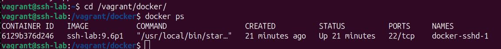

# Lab : Reproduction et Analyse de la Vulnérabilité "SSHole" (CVE-2026-123158, score CVSS de 8,1)

>  **Avertissement Légal (Disclaimer)** : Ce dépôt a été conçu uniquement à des fins éducatives, de recherche en sécurité et de démonstration en environnement isolé. L'utilisation des techniques ou configurations présentées ici contre des systèmes sans autorisation explicite est strictement illégale.

## Présentation du Projet

Ce projet met en place un laboratoire local reproductible permettant d'étudier une vulnérabilité critique affectant le démon OpenSSH (**"SSHole"**), liée à la gestion de l'authentification et des signaux/threads dans certaines configurations spécifiques d'OpenSSH.

L'infrastructure repose sur **Vagrant** pour orchestrer une machine virtuelle hôte, et **Docker** pour isoler le conteneur vulnérable tournant sous **Alpine Linux**.

---

## Contexte Technique & Prérequis de la Faille

Pour que cette vulnérabilité soit exploitable et reproductible dans ce laboratoire, un alignement précis de versions et de directives de configuration du serveur SSH (`sshd_config`) est indispensable :

### 1. Environnement Logiciel Vulnérable
* **Système d'exploitation cible :** Alpine Linux `3.19` (environnement léger utilisant `musl libc`, particulièrement pertinent pour étudier le comportement mémoire et le timing de la faille).
* **Service vulnérable :** `openssh-server` version **`9.6p1`** (version antérieure aux correctifs de sécurité de la branche 9.8p1).

### 2. Conditions Critiques de Configuration (`sshd_config`)
La vulnérabilité ne se déclenche pas avec n'importe quelle configuration par défaut. Les paramètres suivants doivent impérativement être actifs dans le conteneur cible :

* **`UsePAM no`** : La désactivation de PAM (*Pluggable Authentication Modules*) force `sshd` à gérer directement le processus d'authentification interne, exposant le chemin d'exécution vulnérable (notamment autour du délai d'expiration de connexion `LoginGraceTime` ou du traitement des routines d'authentification).
* **`PasswordAuthentication yes`** : L'authentification par mot de passe doit être activée afin d'initialiser les structures d'authentification ciblées lors de la phase de pré-authentification.
* **`PermitRootLogin yes`** *(Optionnel selon le scénario)* : Permet de valider l'impact maximal (obtention d'un shell `root` à distance sans authentification préalable).
* **`LoginGraceTime`** : La fenêtre temporelle par défaut (`120s`, souvent réduite dans le lab pour accélérer la preuve de concept) joue un rôle clé si l'exploitation repose sur une condition de course (*Race Condition*).

---

## Prérequis Système (Machine Hôte)

Avant de lancer le laboratoire, assurez-vous que les outils suivants sont installés sur votre machine :
* [Git](https://git-scm.com/)
* [Vagrant](https://www.vagrantup.com/) (v2.3+)
* Un hyperviseur compatible (VMware)
* Un client SSH standard (`openssh-client`)

---

## Installation et Lancement du Laboratoire

Suivez ces étapes dans l'ordre pour déployer l'environnement :

### 1. Cloner le dépôt
```bash
git clone [https://github.com/](https://github.com/)diallocode/SSHOLE-POC.git
cd SSHOLE-POC
```

### 2. Démarrer l'environnement Vagrant
```bash
vagrant up
```

### 3. Déployer le conteneur vulnérable
À l'intérieur de la VM Vagrant, déplacez-vous dans le répertoire partagé contenant l'environnement Docker et verifiez que le conteneur est bien demarrer :

```bash

```

### 4. Reproduction de la Vulnérabilité (PoC)

#### 1. Se connecter à la VM et accéder au répertoire Docker
```bash
vagrant ssh
cd /vagrant/docker
```

#### 2. Vérifier que le conteneur cible est opérationnel
```bash 
docker ps
```
Vous devriez voir un conteneur basé sur alpine:3.19 a l'interieur sous le nom : sshole-lab-sshd-1

#### 3. Vérifier la configuration vulnérable effective dans le conteneur
```bash
sudo docker compose exec -u root sshd sh
```
Une fois connecté, vous pouvez verifiez les fichier sshd_config et recupere l'IP du conteneur.
```bash
cat /etc/ssh/sshd_config
```

#### 4. Identifier un compte cible sans mot de passe
La faille exploite les comptes dont le champ mot de passe dans /etc/shadow est *, typiquement les comptes configurés pour une authentification par clé uniquement.
```bash
cat /etc/shadow
```
Sur Alpine, root est souvent dans ce cas si aucun mot de passe n'a été défini. Un autre utilisateur non route ayant la meme config est egalement present dans ce fichier.

#### 5. Tenter l'authentification bypass (PoC)
Depuis la VM Vagrant, utilise le client SSH avec un mot de passe surdimensionné (entre 257 et 1024 octets). Le mécanisme exact : crypt() de musl retourne la chaîne "*" pour une entrée trop longue, ce qui correspond exactement au hash stocké pour les comptes sans mot de passe. sshd interprète cette égalité comme une authentification réussie.
```bash
ssh root@<ip_container>
```
Entrez une premiere fois un faux mot de passe pour recuperer le sel d'un utilisateur existant.

Génère un mot de passe de 300 caractères et retente avec ce dernier.

Si la connexion aboutit sans erreur d'authentification, la vulnérabilité est confirmée. Tu obtiens un shell root dans le conteneur.

## Correction de la Faille
### Mise a jour(recommandee)
```bash
apk upgrade -U -a
```
Attention : un simple apk upgrade sans redémarrage du service ne suffit pas, le démon en cours d'exécution conserve l'ancien binaire.

### Attenuation immediate(Si la mise a jour n'est pas possible)
La mesure la plus efficace est de désactiver l'authentification par mot de passe, ce qui coupe le chemin d'exploitation sans nécessiter de mise à jour.

Dans le conteneur, édite /etc/ssh/sshd_config
```bash
PasswordAuthentication no
```
Puis redémarre sshd.

### Vérification post-correction
La connexion doit désormais échouer avec **Permission denied**.

capture a inserer

## Nettoyage de l'environnement
```bash
exit 
vagrant destroy -f
```


## Captures d'écran

### Étape 1 — Conteneur actif


### Étape 2 — PoC avant correction

*Figure 2 — Bypass d'authentification réussi : shell root obtenu sans mot de passe valide.*

### Étape 4 — PoC après correction

*Figure 4 — Après application de l'atténuation, la connexion est refusée.*
