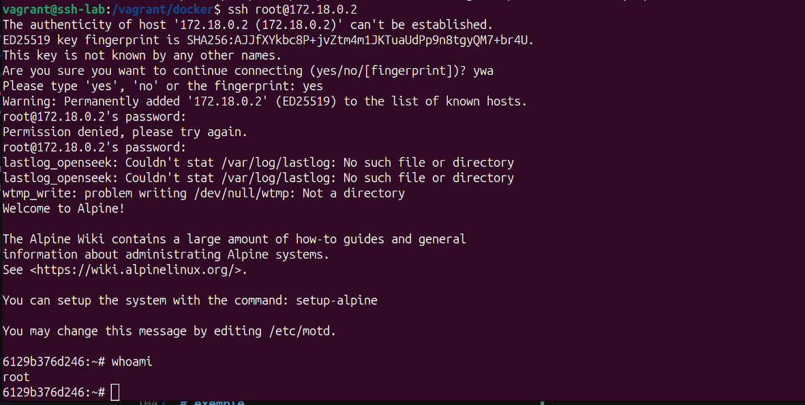

# SSHole on Alpine Linux — an OpenSSH authentication case study

**CVE-2026-123158 · CVSS v3.1: 8.1 (High)**

This repository documents my investigation of a reported OpenSSH password authentication bypass on Alpine Linux. I built a local Docker Compose environment to study the behavior of an affected package and recorded how the server responded before and after I disabled password authentication.

The Docker setup in [`docker/`](docker/) runs independently. I also included an optional Vagrant environment for running the same container inside a dedicated virtual machine.

## What I investigated

I wanted to understand how an SSH server could accept a password for a local account that had no usable password hash. The published explanation traces the issue to the boundary between OpenSSH and musl libc. In the affected authentication path, a password-hashing error could produce a value that `sshd` treated as a match. An error during verification could therefore result in a successful login.

My contribution was to reproduce the reported behavior in a controlled environment, document the software configuration, and compare the observed login outcome before and after applying a configuration mitigation. The explanation of the underlying defect comes from the upstream and distribution advisories linked below.

## Lab environment

| Component | Role |
|---|---|
| Alpine Linux 3.19 | Container operating system |
| OpenSSH 9.6p1 and musl libc | SSH daemon and C library examined in the study |
| Docker Compose | Defines the lab service and its configuration |
| Vagrant and VMware (optional) | Place the Docker environment inside a separate guest OS |

There are two ways to use the project. On a host with Docker and Compose, the files in `docker/` are sufficient. For the VM-based setup, Vagrant provisions the guest and installs Docker there. Both approaches use the same container definition, so the SSH configuration is maintained in one place.

## Observations

| Lab state | Recorded observation |
|---|---|
| Baseline | The lab server opened a session for the test account without a valid password. |
| After disabling SSH password authentication | The server rejected the password-based login attempt. |

### 1. Container status


The process listing identifies the running container. The Alpine package revision is checked separately because the image tag alone does not identify the installed OpenSSH build.

### 2. Baseline authentication result



The session shown here belongs to the lab container. The account reached in this experiment depended on the SSH policy and local accounts configured in that image.

### 3. Result after mitigation


With password authentication disabled, the server rejected the login attempt. This records the effect of the configuration change. Verifying a package update requires a separate check of the installed revision and a restart of the running daemon.

## Remediation and verification

### Install the distribution fix

Alpine backported the fix to `9.6_p1-r3` on the 3.19 branch. The upstream version string `9.6p1` alone cannot distinguish the affected and corrected Alpine packages.

For a container deployment, update the package in the image build, rebuild the image, and recreate the service so that the running daemon uses the updated binary. From the `docker/` directory, check the distribution version and the full package revision in the running container:

```sh
docker compose exec sshd cat /etc/alpine-release
docker compose exec sshd apk info -v openssh-server
```

Compare the package revision with the fixed version listed for the corresponding Alpine branch.

### Disable password authentication

Alpine also documents disabling SSH password authentication as a mitigation. Before changing a remotely administered system, verify that key-based administrative access works and keep the current session open until a fresh login succeeds.

For this project, the persistent configuration is in [`docker/config/sshd_config`](docker/config/sshd_config):

```text
PasswordAuthentication no
```

After applying the configuration to the service, validate its syntax and inspect the effective default setting:

```sh
docker compose exec sshd sshd -t
docker compose exec sshd sshd -T | grep '^passwordauthentication '
```

The expected output from the second command is `passwordauthentication no`. If the configuration contains `Match` blocks, also check the effective settings for the relevant user and connection. Finally, confirm that a fresh key-based administrative session succeeds.

## References

- [Alpine Linux security advisory — OpenSSH server password authentication bypass](https://www.alpinelinux.org/posts/2026-11-05-openssh-password-authentication-bypass/)
- [OpenSSH 10.6p2 release notes](https://www.openssh.org/txt/release-10.6p2)
- [NIST National Vulnerability Database — CVE-2026-123158](https://nvd.nist.gov/vuln/detail/CVE-2026-123158)